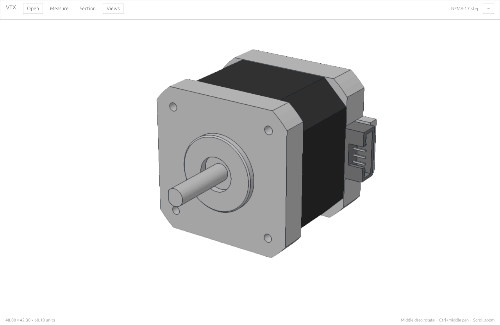
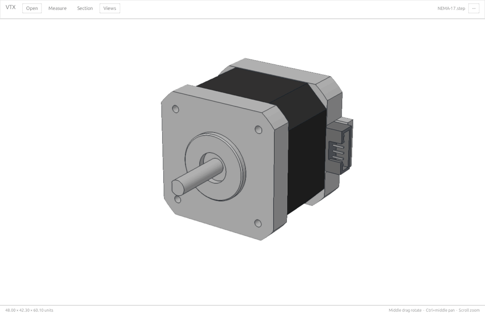
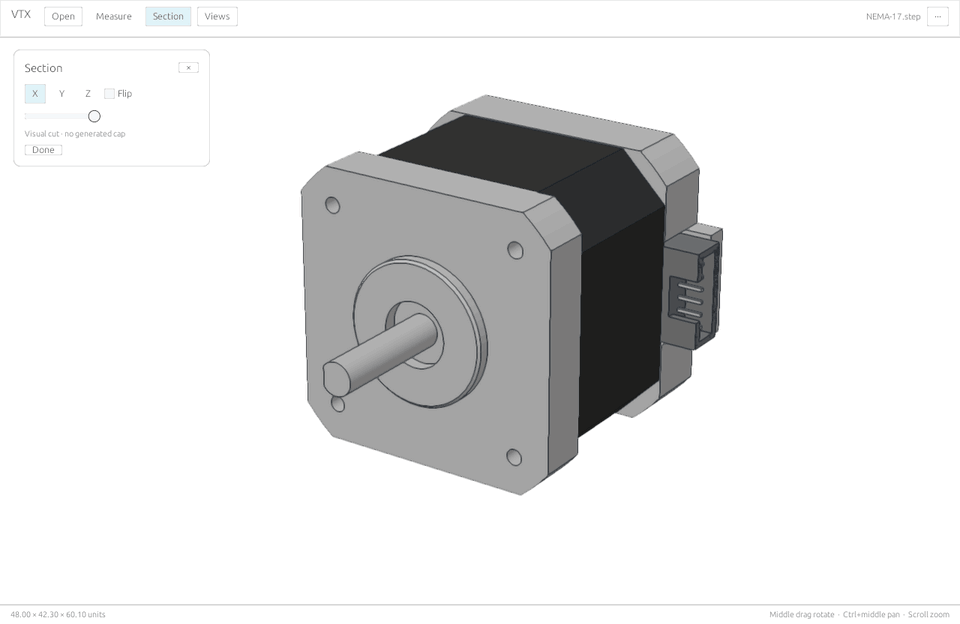
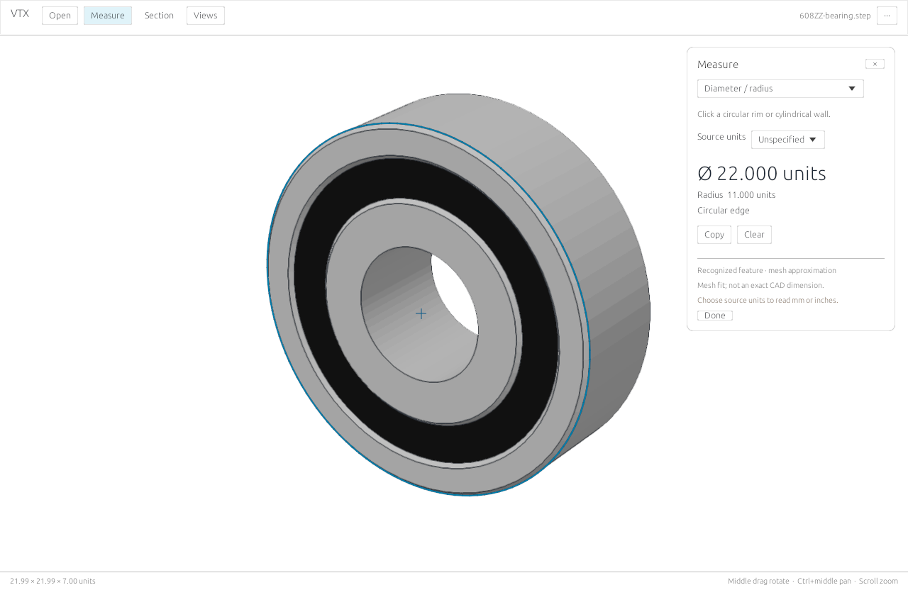
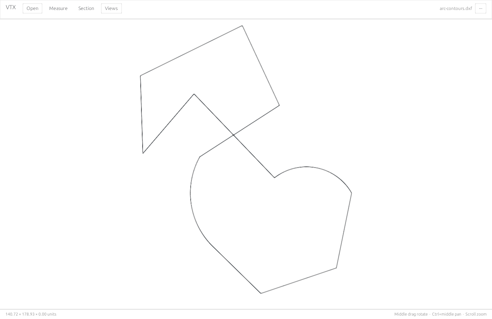

# VTX

A fast, local CAD and 3D viewer. Minimal UI, clear views, familiar controls.

**Download:** [Windows installer](https://github.com/vineetpadia/vtx/releases/latest/download/VTX-Setup.exe) · [Mac Apple silicon](https://github.com/vineetpadia/vtx/releases/latest/download/vtx-macos-arm64.zip) · [Mac Intel](https://github.com/vineetpadia/vtx/releases/latest/download/vtx-macos-x64.zip) · [Linux](https://github.com/vineetpadia/vtx/releases/latest/download/vtx-linux-x64.tar.gz)

Releases are private; sign in to GitHub with repository access. [Installation help and portable downloads →](docs/INSTALL.md)

## Features

- **Measure:** select lines and curves; compare edge gaps, lengths, and angles. Measure point distances, XYZ offsets, diameters, and radii, with snapping and mm/inch display.
- **Section:** slide an X, Y, or Z cutting plane through a model.
- **Clear CAD views:** white background, edge outlines, supported colors, transparency, and labels. Standard views and orthographic projection.
- **Familiar navigation:** SolidWorks-style mouse controls and zoom toward the pointer.
- **3D models and 2D drawings:** SolidWorks, STEP, STL, OBJ, PLY, glTF/GLB, FBX, 3MF, IFC, and DXF. IGES through an optional extension.
- **Local viewing:** no model uploads or separate CAD application required.
- **Windows extras:** background auto-updates and an optional, separately installed navigable Explorer preview.

Mesh measurements are approximate; SolidWorks appearances and DXF entities have limits. [Format and tool details →](docs/INSTALL.md#open-a-model)

## In action

| Orbit a model | Move a section plane |
|:---:|:---:|
|  |  |

| Measure a diameter | Open a DXF drawing |
|:---:|:---:|
|  |  |

Openly licensed examples: [model sources and credits](docs/media/SOURCES.md). Visuals use VTX's native renderer; GIFs use scripted motion, not real-time performance recordings.

## Controls

Drop a file or press **Ctrl+O** (**⌘O** on Mac). **Middle-drag** rotates, **Ctrl+middle-drag** pans, **scroll** zooms, and **F** fits. Click an edge to measure; **Ctrl-click** a second to compare. **Esc** clears tools.

[Build from source](docs/DEVELOPMENT.md) · [Benchmarks](docs/BENCHMARKS.md) · [Release notes](docs/RELEASE_NOTES.md) · [Explorer preview setup](native/windows-preview/README.md)

STEP core based on [Formlabs Foxtrot](https://github.com/formlabs/foxtrot) ([MIT](native/LICENSE-MIT) / [Apache 2.0](native/LICENSE-APACHE)). [SolidWorks reader attribution](vendor/sldprt/NOTICE.md) · DXF decoding by [dxf-rs](https://github.com/ixmilia/dxf-rs) (MIT).
